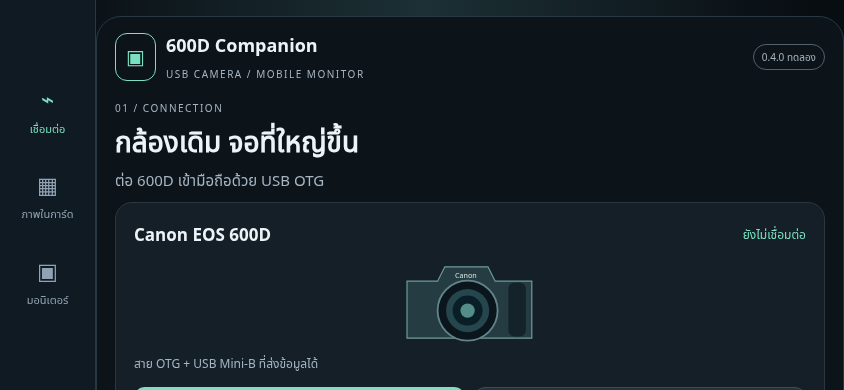
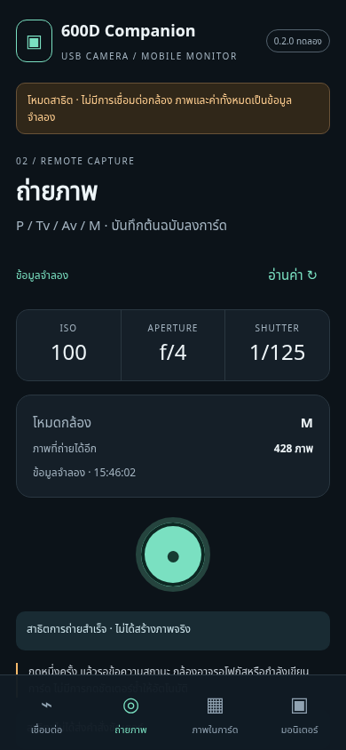

# Canon EOS to mobile — 600D Companion

Independent open-source Android USB companion for Canon EOS cameras.
**Initial prototype targets only the Canon EOS 600D / Rebel T3i / Kiss X5.**
แอปภาษาไทยสำหรับต่อ Android เข้ากล้องด้วย USB OTG โดยไม่ต้องลงเฟิร์มแวร์เพิ่ม

**สถานะ: 0.1.1-prototype — ยังไม่ทดสอบบน Android/emulator หรือกล้องจริง**
ผ่านการบิลด์ ตรวจลายเซ็น APK และทดสอบโปรโตคอลกับอุปกรณ์จำลอง/หน้าเมนูบนคอมพิวเตอร์เท่านั้น
ไม่มี Live View ในรุ่นนี้

## ดาวน์โหลดและเริ่มทดลอง

- **[ดาวน์โหลด APK สำหรับ Android](downloads/0.1.1/600D-Companion-0.1.1-prototype.apk?raw=true)** — เปิดไฟล์แล้วติดตั้งบนมือถือ Android 8 ขึ้นไป
- [คู่มือภาษาไทย](docs/INSTALL_TH.md)
- [ซอร์ส ZIP ของรุ่นนี้](downloads/0.1.1/600D-Companion-0.1.1-source.zip?raw=true)
- [SHA256SUMS](downloads/0.1.1/SHA256SUMS) / [ข้อมูลบิลด์](downloads/0.1.1/BUILD_INFO.json)
- [ผลตรวจบนคอมพิวเตอร์และสิ่งที่ยังต้องทดสอบ](docs/TEST_RESULTS.md)

บน GitHub หากไฟล์ APK ไม่เริ่มดาวน์โหลด ให้เปิดไฟล์แล้วกด **Download raw file**
APK นี้สำหรับมือถือ **ไม่ใช่เฟิร์มแวร์ ห้ามเปลี่ยนชื่อเป็น AUTOEXEC.BIN หรือลงผ่าน Firmware Update บนกล้อง**

รุ่นนี้บิลด์ใหม่หลังแยก repository และใช้กุญแจลงนาม prototype ใหม่
หากลง 0.1.0 ไว้แล้ว Android อาจไม่ยอมอัปเดตทับ ต้องถอนรุ่นเดิมก่อนติดตั้ง ดู [บันทึกการย้าย](docs/MIGRATION.md)

## เมนู

| เมนู | การทำงาน |
|---|---|
| เชื่อมต่อ | ขอสิทธิ์ USB, ตรวจรุ่น/เฟิร์มแวร์, ยกเลิกการเชื่อมต่อ, ลองหน้าจอจำลอง |
| ถ่ายภาพ | อ่าน ISO/รูรับแสง/ชัตเตอร์/โหมด/ภาพที่เหลือ และส่งคำสั่งชัตเตอร์ |
| ภาพในการ์ด | ตรวจ JPEG จาก 80 handles ท้ายที่กล้องส่ง, ดูภาพย่อ, รับ JPEG สำเนาเข้ามือถือ |
| คู่มือ | วิธีต่อสาย ข้อจำกัด และข้อความสถานะในเครื่อง |

โหมดสาธิตไม่ส่งคำสั่งกล้องและใช้ภาพวาด/ตัวเลขจำลอง มีป้ายระบุชัดเจน
ภาพด้านล่างเป็น screenshot ของ HTML ที่บรรจุใน APK บน browser **ไม่ใช่ภาพ Android หรือกล้องจริง**

 

## อุปกรณ์และขอบเขต

Android 8+ ที่รองรับ USB Host/OTG, WebView ที่อัปเดต, อะแดปเตอร์ OTG และสาย **USB Mini-B ที่ส่งข้อมูลได้**
ตั้งกล้อง M, เลนส์ MF, ภาพเดี่ยว, JPEG หรือ RAW+JPEG, ชัตเตอร์ 1/125 และมีการ์ดพร้อมบันทึก
มือถือกับกล้องใช้แบตเตอรี่ของตัวเอง ไม่ใช่การชาร์จกล้องผ่าน USB

แอปไม่เขียนเฟิร์มแวร์ ไม่ลบ/format การ์ด ไม่เปลี่ยนค่าแสงหรือ Picture Style และไม่เปลี่ยนปลายทางบันทึกให้เอง
ต้นแบบสั่งชัตเตอร์เมื่ออ่านยืนยัน M/MF/ภาพเดี่ยว/ชัตเตอร์ปกติและ card destination=2 ได้เท่านั้น
การรับคำสั่งชัตเตอร์ไม่ใช่หลักฐานว่ากล้องเขียนไฟล์เสร็จ ต้องตรวจภาพในการ์ดจริง
ยังไม่มี autofocus, Live View, วิดีโอ, RAW/MLV download, LUT, Time-lapse หรือถ่ายคร่อม
จำนวนรุ่นกล้องอื่นที่รองรับ **ยังไม่มีการยืนยัน**

## พัฒนาและบิลด์

Linux x86_64, Java 21+, Python 3.9+; ใช้ API 35, build-tools 35.0.0 และ ECJ 3.39.0
ไม่มี Gradle/AndroidX และไม่มี native ABI dependency

```sh
python3 tools/setup-tools.py build/toolchain
bash test.sh
bash build-android.sh
```

ผลลัพธ์ `build/600D-Companion-0.1.1-prototype.apk`
SDK และ compiler ดาวน์โหลดจากแหล่งทางการพร้อมตรวจ SHA-256 เครื่องมือยังอยู่ภายใต้ใบอนุญาตของแต่ละโครงการ
กุญแจ prototype สร้างใน `build/` ซึ่งไม่เข้า Git ไม่ใช่กุญแจเผยแพร่ระยะยาว

ดูเมนูบน browser (สาธิตเท่านั้น):

```sh
python3 -m http.server 8765 --directory app/src/main/assets
# เปิด http://localhost:8765
# อีก terminal ที่มี Node, Playwright และ Chromium:
NODE_PATH=/path/to/node_modules node tests/ui.cjs
```

กำหนด `TOOLCHAIN`, `SDK_PLATFORM`, `BUILD_TOOLS`, `ECJ_JAR`, `CHROMIUM_PATH` และ `PREVIEW_URL` เพื่อใช้เครื่องมือที่มีอยู่ได้

## ที่มาและใบอนุญาต

แยกแนวคิดและต้นแบบ Android ออกจาก [โครงการเฟิร์มแวร์ Canon 600D Photo UI](https://github.com/itsamachom/EOS_ROM_MLV_Modify)
repository นี้มีเฉพาะแอป Android ไม่มี AUTOEXEC.BIN, FIR, Canon ROM หรือซอร์สเฟิร์มแวร์ ML

PTP implementation เขียนใหม่ ไม่บรรจุ libgphoto2; อ้างอิงข้อเท็จจริงของโปรโตคอลจาก:

- [libgphoto2 library.c](https://github.com/gphoto/libgphoto2/blob/master/camlibs/ptp2/library.c): 600D VID/PID และลำดับ remote shutter
- [ptp.h](https://github.com/gphoto/libgphoto2/blob/master/camlibs/ptp2/ptp.h): operation/property identifiers
- [ptp-pack.c](https://github.com/gphoto/libgphoto2/blob/master/camlibs/ptp2/ptp-pack.c): EOS property event layout
- [config.c](https://github.com/gphoto/libgphoto2/blob/master/camlibs/ptp2/config.c): การแปลค่ากล้อง

ซอร์สแอปใช้ [MIT License](LICENSE) ไม่ได้เปลี่ยนใบอนุญาตของเฟิร์มแวร์เดิมหรือไลบรารีภายนอก
มี Codex/LLM ช่วยพัฒนาและตรวจ เป็นโครงการอิสระ ไม่ใช่ Canon Camera Connect และไม่ได้รับการรับรองจาก Canon/Magic Lantern/libgphoto2
