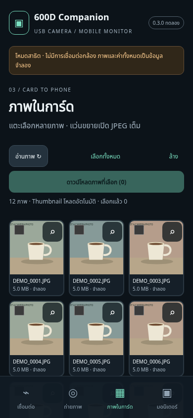
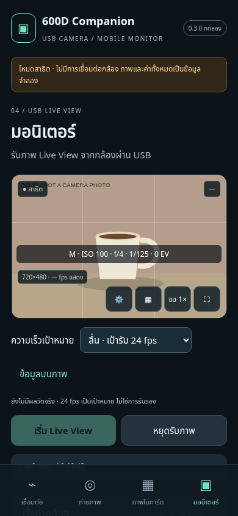

# Canon EOS to mobile — 600D Companion

Independent open-source Android USB companion for **Canon EOS 600D / Rebel T3i / Kiss X5**.
แอปภาษาไทยสำหรับต่อกล้องเข้ามือถือด้วย USB OTG ไม่ต้องติดตั้งเฟิร์มแวร์เพิ่ม

**รุ่นล่าสุด: 0.3.0-prototype** — ลดการรอ Live View, ใช้เฟรมล่าสุด และปรับค่า ISO/รูรับแสง/ชัตเตอร์/EV จากแอป
ผ่านการบิลด์และทดสอบจำลองบนคอมพิวเตอร์แล้ว **ยังไม่ได้ทดสอบรุ่น 0.3.0 บนมือถือ/กล้องจริง**
ผู้ใช้รายงานว่า Live View ใน 0.2.0 ยังหน่วง รุ่นนี้ปรับทางส่งภาพและเพิ่มค่าประสิทธิภาพสำหรับทดสอบกับ 600D จริง

## ดาวน์โหลด

- **[APK 0.3.0 สำหรับ Android](downloads/0.3.0/600D-Companion-0.3.0-prototype.apk?raw=true)**
- [วิธีติดตั้งและทดสอบภาษาไทย](docs/INSTALL_TH.md)
- [ซอร์ส ZIP ตรงกับรุ่นนี้](downloads/0.3.0/600D-Companion-0.3.0-source.zip?raw=true)
- [SHA256SUMS](downloads/0.3.0/SHA256SUMS) / [BUILD_INFO](downloads/0.3.0/BUILD_INFO.json)
- [สิ่งที่เปลี่ยนใน 0.3.0](docs/RELEASE_0.3.0.md) / [ผลตรวจและข้อจำกัด](docs/TEST_RESULTS.md)

เปิด APK แล้วกด **Download raw file** หาก GitHub ไม่เริ่มดาวน์โหลด
APK สำหรับมือถือ ไม่ใช่ AUTOEXEC.BIN และไม่ใช่ไฟล์ Firmware Update ของกล้อง

ใช้กุญแจ prototype **เดียวกับ APK 0.1.1/0.2.0 ที่เผยแพร่ใน repository** ตรวจ certificate digest ตรงกันแล้ว และเพิ่ม versionCode เป็น 4
จึงเตรียมไว้ให้ติดตั้งทับ 0.1.1/0.2.0 ได้ หากเป็น 0.1.0/ไฟล์ที่ลงนามเอง อาจต้องถอนรุ่นเดิมก่อน
กุญแจส่วนตัวไม่เข้า Git หรือซอร์ส ZIP

## เมนูปัจจุบัน

| เมนู | การทำงาน |
|---|---|
| เชื่อมต่อ | ขอสิทธิ์ USB, อ่านรุ่น/firmware, สาธิตหน้าจอ, คัดลอกสถานะวินิจฉัย |
| ถ่ายภาพ | P / Tv / Av / M, อ่าน/ปรับค่าตามโหมดที่กล้องอนุญาต, ส่งชัตเตอร์และแสดงสถานะ |
| ภาพในการ์ด | ตาราง Thumbnail อัตโนมัติ, แตะเลือกหลายภาพ, ดู JPEG เต็ม, ดาวน์โหลด 1–80 ภาพต่อชุด |
| มอนิเตอร์ | เฟรมล่าสุด เป้ารับ 24/12 fps, วัดรับ/แสดง/เวลาอ่านเฟรม, HUD ค่ากล้อง, เส้นตาราง/ขยายจอ |

ตัดหน้าคู่มือออกจากแอปแล้ว คู่มือยังอ่านได้ใน repository
ภาพด้านล่างเป็น **browser screenshot ของ UI ที่บรรจุใน APK ในโหมดสาธิต** ไม่ใช่ภาพจากกล้อง/มือถือจริง และไม่ใช่ผลวัดประสิทธิภาพกล้อง

 

## ภาพย่อกับภาพชัดต่างกันอย่างไร

0.1.1 ใช้ GetThumb ตอนกดดู จึงขยายภาพย่อเล็ก ๆ จนมัว
0.2.0 ใช้ Thumbnail เฉพาะตาราง และ **รับ JPEG ต้นฉบับด้วย GetObject เมื่อกดแว่นขยาย**
แสดงขนาดพิกเซล/ขนาดไฟล์ มีพอดีจอและ 100% และแคชไว้ใช้ดาวน์โหลดต่อ
ความละเอียดสูงสุดขึ้นอยู่กับ JPEG ที่กล้องบันทึกจริง ไม่ได้เพิ่มรายละเอียดเกินไฟล์ต้นฉบับ หากต้องการภาพใหญ่ให้ตั้ง JPEG L หรือ RAW+JPEG L บนกล้อง
ยังไม่เปิดไฟล์ RAW/MLV

## ปรับค่ากล้องจากแอป

แผงตั้งค่ามีทั้งหน้าถ่ายภาพและมอนิเตอร์ เลือกได้เฉพาะค่าใน EOS option list ที่กล้องส่งมา ไม่สร้างช่วงค่าเอง
แอปสั่งเปลี่ยนจริงผ่าน EOS property write แล้วรอ event อ่านกลับ ไม่แสดงค่าที่เลือกเป็นค่าจริงทันทีเพียงเพราะกล้องตอบรับคำสั่ง
ถ้ายังไม่มีรายการตัวเลือก ช่องจะปิดและบอกให้ลองอ่านค่าใหม่

| โหมดที่ตั้งบนกล้อง | ISO | รูรับแสง | ชัตเตอร์ | ชดเชย EV |
|---|---|---|---|---|
| P | ✓ | กล้องคุม | กล้องคุม | ✓ |
| Tv | ✓ | กล้องคุม | ✓ | ✓ |
| Av | ✓ | ✓ | กล้องคุม | ✓ |
| M | ✓ | ✓ | ✓ | ปิดในรุ่นนี้ |

ต้องมีตัวเลือกจริงจากกล้อง/เลนส์จึงปรับได้ การหมุนโหมดทำที่ตัวกล้อง
ไม่เปลี่ยนค่าใน Movie/ขณะ REC/กล้อง busy และไม่รับ property อื่นจาก bridge เช่น firmware/Picture Style
แอปไม่ย้อนค่าการถ่ายภาพที่คุณตั้งเองเมื่อหยุดมอนิเตอร์ คืนเฉพาะ EVF ที่แอปเปิดไว้ตามเงื่อนไขเดิม
**ยังไม่ได้ยืนยันการปรับค่าบน 600D จริงในรุ่นนี้**

## Live View ลดความหน่วง

0.2.0 พักเพิ่ม 150 ms หลังการรับแต่ละเฟรม ทำให้มีเพดานต่ำกว่า 6.7 fps ก่อนรวมเวลารับภาพ/แสดงผล
0.3.0 เปลี่ยนเป็นงบเวลาประมาณ 24 fps (หรือ 12 แบบประหยัด) และ:

- ตัวรับ USB ไม่รอ browser วาดภาพ เฟรมเก่าจะถูกแทนด้วยเฟรมล่าสุด ไม่สะสมคิวรอเล่นย้อนหลัง
- ส่ง JPEG ผ่าน app-local URL/stream ในหน่วยความจำ ไม่แปลง Base64 ไม่เขียนไฟล์ชั่วคราวต่อเฟรม และห้ามเก็บ live frame ใน HTTP cache
- ใช้ USB read buffer เดิม ลดการคัดลอก/สร้าง buffer และอ่านขนาด JPEG จาก SOF โดยไม่ decode raster ทุกเฟรม
- หน้าจอขอภาพถัดไปหลังเตรียมแสดงภาพปัจจุบัน ไม่กำหนดให้กล้องรอ ACK การวาด
- แสดงอัตรา JPEG ที่รับ/ภาพที่ browser โหลดไปแสดง, เวลาเรียกอ่านเฟรม และเวลาจากรับเสร็จถึง callback การแสดงผล

**24 fps เป็นเป้าหมายการเรียกอ่าน ไม่ใช่ผลทดสอบหรือการรับประกัน** เวลาตอบของกล้อง/USB และการ decode/วาดบนมือถือยังเป็นขีดจำกัด
จำนวน JPEG ตอบกลับไม่ใช่หลักฐานว่าเซ็นเซอร์สร้างภาพใหม่ทุกครั้ง ตัวเลขนี้ไม่ใช่ fps ของ MOV
เวลาหลังรับไม่ใช่ motion-to-photon latency ทั้งระบบ และไม่รวมเวลาที่ภาพค้างอยู่ในกล้องก่อนส่ง
เลือกเป้า 24 แล้วส่งผลวัดจริงหลังรันสักครู่เพื่อประเมินคอขวด

## เหมือนจอหลังกล้องแค่ไหน / วิดีโอ

USB Live View ของ Canon เป็นโปรโตคอล PTP/EOS ไม่ใช่ UVC หรือ HDMI
แอปเปิด EVF และส่งภาพไป PC/USB แล้วอ่านเฟรม 0x9153; หน้าจอกล้องอาจดับระหว่างส่งภาพ
หยุดเมื่อออกจากหน้ามอนิเตอร์หรือแอปเข้าเบื้องหลัง และพยายามคืนเฉพาะค่า EVF ที่แอปเปลี่ยน
ไม่ส่งคำสั่งเริ่ม/หยุดบันทึกวิดีโอ และไม่ปิด EVF mode ถ้ารายงานว่ากำลังบันทึก/อยู่โหมด Movie/ไม่ทราบสถานะ recording

- รับ JPEG ใน EOS segment 1/11 และ segment 9 **เฉพาะเมื่อข้อมูลข้างในเป็น JPEG จริง**
- segment 9 แบบ RAW/non-JPEG ยังแสดงไม่ได้ จะแจ้งข้อจำกัด ไม่สร้างภาพจำลองแทน
- โหมดวิดีโอและการส่งภาพขณะ REC **ยังต้องทดสอบกับ 600D จริง** ถ้ากล้องหยุดส่งเฟรม แอปแสดงป้ายภาพค้าง
- ลองเริ่มมอนิเตอร์ก่อนเริ่ม REC แล้วควบคุม REC ที่ตัวกล้อง การส่งเฟรมต่อเนื่องระหว่างบันทึกไม่รับประกันทุกโหมด
- fps คืออัตราเฟรมที่แสดงบนมือถือ ไม่ใช่ fps ที่เซ็นเซอร์อ่านหรือเฟรมที่บันทึกลง MOV
- เป็นภาพตัวอย่างจากกล้อง มี HUD ISO/รูรับแสง/ชัตเตอร์/EV ของแอปเอง ไม่ใช่ภาพคัดลอกเมนู Canon, AF boxes หรือ ML overlays ทั้งจอ และไม่ใช่ Full HD/4K monitor ที่รับรองความละเอียดหรือ latency

## การดาวน์โหลดหลายภาพ

เลือกได้ไม่เกิน 80 ภาพต่อชุด เลือกโฟลเดอร์ปลายทางผ่าน Android **ครั้งเดียวต่อชุด**
แอปจะอ่านและบันทึกทีละไฟล์ตามคิว USB ไม่เปิดหลาย PTP transactions พร้อมกัน ไม่ลบต้นฉบับ
มีจำนวนที่เสร็จ/ล้มเหลว และหยุดหลังไฟล์ปัจจุบันได้ ภาพที่ยังไม่สำเร็จยังคงถูกเลือกเพื่อให้ลองใหม่
JPEG ที่ส่งออกเป็นไฟล์ต้นฉบับพร้อม EXIF ไม่บีบอัดภาพใหม่

## อุปกรณ์และข้อจำกัด

Android 8+ ที่รองรับ USB Host/OTG, WebView ที่อัปเดต, OTG ตรงพอร์ต และสาย USB **Mini-B ที่ส่งข้อมูลได้**
กล้องและมือถือใช้แบตเตอรี่ของตนเอง ใส่การ์ด JPEG หรือ RAW+JPEG ภาพเดี่ยว ใช้ P/Tv/Av/M ไม่ใช้ Bulb
ถ้า AF ไม่ยอมถ่าย ให้ทดลองเลนส์ MF ก่อน
แอปปรับค่าแสงเฉพาะที่คุณเลือก ไม่เปลี่ยน Picture Style ไม่เขียนเฟิร์มแวร์ และไม่ format การ์ด
ไม่มี touch autofocus, USB movie recording, RAW/MLV download, LUT, Time-lapse หรือถ่ายคร่อม
ยังไม่ยืนยันรองรับกล้องรุ่นอื่นหรือ ML ทุกบิลด์

## บิลด์และทดสอบ

Linux x86_64, Java 21+, Python 3.9+; Android API 35, build-tools 35.0.0, ECJ 3.39.0
ไม่มี Gradle/AndroidX หรือ native ABI dependency

```sh
python3 tools/setup-tools.py build/toolchain
bash test.sh
bash build-android.sh
```

ผลลัพธ์ `build/600D-Companion-0.3.0-prototype.apk`
กำหนด `TOOLCHAIN` เพื่อใช้ SDK/ECJ ที่มีอยู่แล้วได้ กุญแจ prototype อยู่ใน build/ ซึ่งไม่เข้า Git อย่าลบทิ้งถ้าต้องการเซ็นอัปเดตทับรุ่นของคุณต่อไป
ถ้าบิลด์เองโดยไม่มี private key เดิม จะได้กุญแจของเครื่องคุณ ไม่ใช่ลายเซ็นของ APK ที่แจก
SDK/ECJ มีใบอนุญาตของแต่ละโครงการแยกจากซอร์สแอป

ทดสอบเมนูด้วย browser (ใช้ได้เฉพาะสาธิต ไม่มี WebUSB):

```sh
python3 -m http.server 8765 --directory app/src/main/assets
# อีก terminal ที่ติดตั้ง Node, Playwright, Chromium แล้ว:
NODE_PATH=/path/to/node_modules node tests/ui.cjs
```

ปรับ `PREVIEW_URL` / `CHROMIUM_PATH` ให้ตรงเครื่องได้
0.3.0 มี PTP/EOS/frame-mailbox/settings assertions และ 2,000 malformed parser cases พร้อม browser flow tests ดูจำนวนตรงรุ่นใน BUILD_INFO/TEST_RESULTS
USB permissions, Android folder picker, lifecycle, camera output/AF/recording และประสิทธิภาพจริงยังต้องทดสอบบนอุปกรณ์

## ที่มาและใบอนุญาต

โครงการ Android แยกจาก [EOS_ROM_MLV_Modify](https://github.com/itsamachom/EOS_ROM_MLV_Modify)
ไม่มี ML/Canon firmware, ROM, cloud credential หรือ private signing key รวมใน repository
PTP/EOS implementation เขียนใหม่เพื่อ interoperability ไม่รวม libgphoto2; ตรวจ operation/property และลำดับจาก:

- [library.c](https://github.com/gphoto/libgphoto2/blob/master/camlibs/ptp2/library.c): 600D USB ID, shutter event handling, EVF setup และ frame segments
- [ptp.h](https://github.com/gphoto/libgphoto2/blob/master/camlibs/ptp2/ptp.h): PTP/EOS identifiers
- [ptp.c](https://github.com/gphoto/libgphoto2/blob/master/camlibs/ptp2/ptp.c): EOS property data-out layout และ GetViewFinderData arguments
- [ptp-pack.c](https://github.com/gphoto/libgphoto2/blob/master/camlibs/ptp2/ptp-pack.c): event layout / CameraStatusChanged
- [config.c](https://github.com/gphoto/libgphoto2/blob/master/camlibs/ptp2/config.c): property types และ recording status

ซอร์สแอปใช้ [MIT](LICENSE) มี Codex/LLM ช่วยพัฒนา/ตรวจ ไม่ใช่ Canon Camera Connect และไม่ได้รับการรับรองจาก Canon/Magic Lantern/libgphoto2
[0.2.0 เดิม](downloads/0.2.0/) และ [0.1.1](downloads/0.1.1/) ยังคงอยู่เพื่ออ้างอิงและย้อนกลับ
